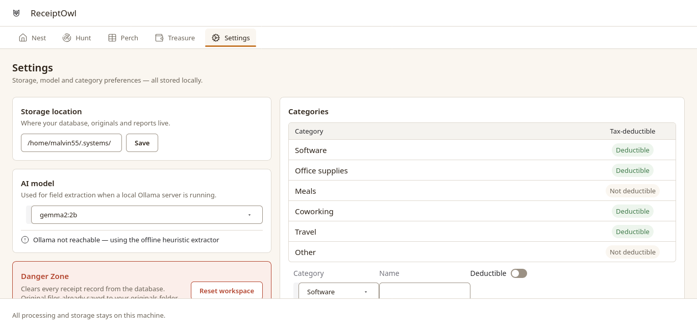
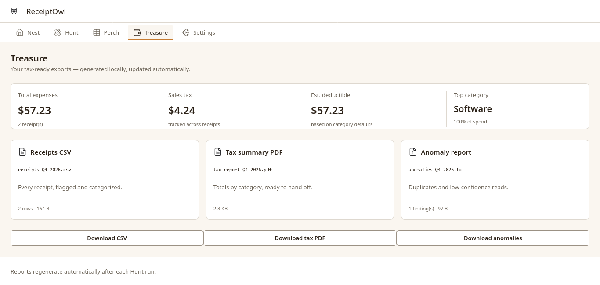

<p align="center">
  
</p>

<h1 align="center">ReceiptOwl</h1>

<p align="center">
  <strong>Sort your receipts. Keep your data.</strong>
</p>

> 🚧 **Project status: Unfinished (and will never be finished).**

## 📸 Screenshots

|               Nest                |                Perch                |
| :-------------------------------: | :---------------------------------: |
|  |  |

|               Hunt                |                 Settings                  |
| :-------------------------------: | :---------------------------------------: |
|  |  |

|                 Treasure                  |
| :---------------------------------------: |
|  |

## ✨ Features

- 🧾 **Receipt management** — organize and review receipt records.
- 🔎 **OCR and extraction** — process receipt information into structured data.
- 🗂️ **Categorization** — organize expenses for easier review.
- 📊 **Spending insights** — explore available summaries and analysis.
- 📤 **Data export** — export supported receipt data.
- 💻 **Desktop interface** — interact with receipts through a graphical application.
- 🔒 **Local-first** — designed to process and store data locally.

Feature availability may vary while development continues.

## ⚙️ How It Works

ReceiptOwl is organized into several application layers:

1. **Input** — provide receipt information or a supported receipt image.
2. **Processing** — the pipeline processes receipt data and extracts available fields.
3. **Validation** — review extracted information and identify potential inconsistencies.
4. **Storage** — receipt records are managed by the database layer.
5. **Management** — browse, review, and organize saved receipts.
6. **Analysis and export** — use available summaries and export functionality.

```text
Receipt Input
     │
     ▼
OCR / Extraction
     │
     ▼
Validation & Processing
     │
     ▼
Database
     │
     ▼
Receipt Management
     │
     ▼
Analysis & Export
```

The exact processing steps depend on the receipt and the functionality enabled in the current version.

## 🛠️ Built With

- **Python** — application logic
- **Gradio** — user interface
- **OCR and processing pipeline** — receipt text extraction and processing
- **Database layer** — receipt persistence
- **Modular architecture** — separated UI, services, pipeline, and database components

See `requirements.txt` for the Python dependencies.

## 🚀 Getting Started

### Prerequisites

- Python 3.12 or a compatible Python version
- Git
- A supported operating system and the dependencies required by the project

### Installation

Clone the repository:

```bash
git clone https://github.com/Malvin555/ReceiptOwl.git
cd ReceiptOwl
```

Create and activate a virtual environment.

**Linux / macOS**

```bash
python -m venv .venv
source .venv/bin/activate
```

**Windows**

```powershell
python -m venv .venv
.venv\Scripts\Activate.ps1
```

Install the dependencies:

```bash
python -m pip install --upgrade pip
pip install -r requirements.txt
```

### Run the application

```bash
python app.py
```

Open the local URL printed in the terminal by Gradio.

> If any installation or startup steps change during development, update this section to match the tested setup.

## 🗺️ Roadmap

- [x] Finalize the core receipt-management workflow.
- [x] Improve receipt extraction and validation.
- [ ] Refine the interface and responsive layouts.
- [ ] Improve error handling and edge cases.
- [x] Add or refine spending insights.
- [x] Verify export workflows.
- [ ] Expand testing and documentation.

## 🔐 Privacy

ReceiptOwl is designed around local data handling. Actual privacy guarantees depend on the enabled processing components, dependencies, and configuration. Review these components before using sensitive financial documents.

**Built by [Malvin555](https://github.com/Malvin555)**
