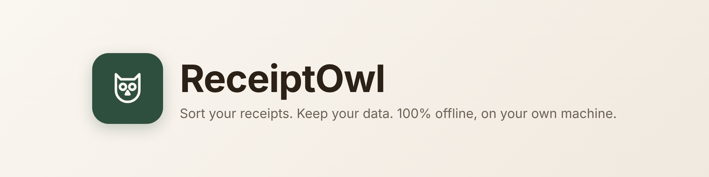
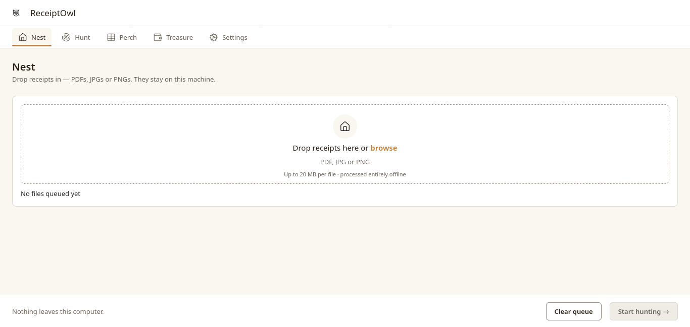
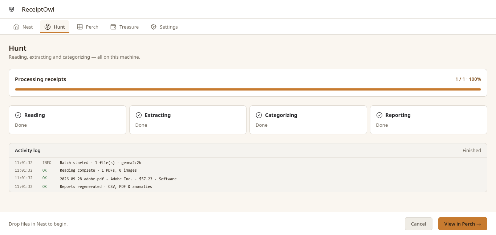
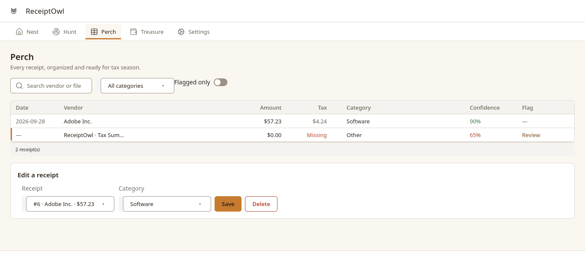

<p align="center">
  
</p>

<p align="center">
  <b>Sort your receipts. Keep your data.</b><br>
  A local app that turns a messy folder of receipts into tax-ready records — OCR, extraction, categorization and reports, entirely offline.
</p>

<p align="center">
  
  
</p>

> **Heads up:** this is a Submission for "Week 2 — Side Hustle" build, not finished. The core loop (upload → OCR → extract → categorize → report) works end to end on real receipts, but there are rough edges — see [Known limitations](#known-limitations). I'm showing it as it stands today rather than waiting for it to be perfect.

---

## Why ReceiptOwl

Freelancers and small side-hustlers end up with receipts scattered across email, phone photos and a shoebox, and no good offline way to turn that into something an accountant (or tax software) can use — without uploading financial documents to a cloud OCR service. ReceiptOwl is a small desktop app that does the sorting for you, using local AI, and never sends a receipt anywhere.

## How it works

ReceiptOwl is five screens, each one stage of the same pipeline:

```
  NEST                HUNT                 PERCH               TREASURE            SETTINGS
  drop receipts   →   OCR + extract   →   review & edit   →   totals & export  ⇄  model, folder,
  (PDF/JPG/PNG)        + categorize        every receipt        reports/PDF        categories
```

1. **🪹 Nest** — drag in receipts (PDF, JPG, PNG). Nothing uploads anywhere; files are hashed and copied into your own local storage folder.
2. **🦉 Hunt** — the pipeline runs live: text-layer read (or OCR fallback) → vendor/amount/date/tax extraction → category match → duplicate/anomaly check. You watch each receipt resolve in real time.
3. **🪵 Perch** — every receipt as an editable table: date, vendor, amount, tax, category, confidence, and any flags (e.g. "missing tax"). Fix anything the extractor got wrong in a couple of clicks.
4. **💰 Treasure** — totals, estimated deductible amount, top spending category, and one-click reports: a CSV of every row, a tax-summary PDF, and an anomaly report — plus the plain folder on disk where everything lives.
5. **⚙️ Settings** — pick the storage location, the local AI model, manage categories, or reset everything in one place.

### Screens

| Nest                                     | Hunt                                     |
| ---------------------------------------- | ---------------------------------------- |
|  |  |

| Perch                                      | Treasure                                         |
| ------------------------------------------ | ------------------------------------------------ |
|  |  |

<p align="center"><b>Settings</b><br></p>

## What makes it "offline-first," not just "offline-capable"

Every stage has a local, dependency-light fallback, so the app works even with nothing extra installed:

| Stage            | Primary                                                                | Fallback                                                                                       |
| ---------------- | ---------------------------------------------------------------------- | ---------------------------------------------------------------------------------------------- |
| OCR              | `pypdf` reads the PDF's text layer directly (fast, no model needed)    | `pytesseract` + system Tesseract for images/scanned PDFs                                       |
| Field extraction | Local **Ollama** server (`127.0.0.1:11434`), default model `gemma2:2b` | Deterministic regex/heuristic extractor — always returns a usable, if lower-confidence, result |
| Categorization   | Keyword match against _your own_ configured categories                 | — (always local, no model needed)                                                              |

No API keys. No cloud calls required to use the app. If Ollama isn't running, ReceiptOwl just says so on Settings and keeps working with the heuristic extractor.

## Tech stack

- **UI:** [Gradio](https://www.gradio.dev/) 6, wrapped in a custom theme/CSS to match the original design rather than Gradio's defaults
- **OCR:** `pypdf`, `pytesseract` (Tesseract)
- **Local AI:** [Ollama](https://ollama.com/) running **Gemma 2 (2B)** by default, with Qwen2.5-3B / Llama 3.2-3B as swappable options
- **Storage:** SQLite (`receiptowl.db`) + content-addressed original files on disk
- **Reports:** `reportlab` (PDF), CSV, plain-text anomaly log

## Getting started

```bash
git clone https://github.com/Malvin555/ReceiptOwl.git
cd ReceiptOwl
python -m venv .venv && source .venv/bin/activate   # Windows: .venv\Scripts\activate
pip install -r requirements.txt
python app.py
```

Open the local URL Gradio prints (usually `http://127.0.0.1:7860`). Everything — database, uploaded originals, reports — is written to `~/Documents/ReceiptOwl` by default (configurable in Settings).

**Optional, for local AI extraction:** install [Ollama](https://ollama.com/) and pull a model, e.g. `ollama pull gemma2:2b`. Without it, ReceiptOwl automatically uses the offline heuristic extractor instead.

## Project layout

```
app.py                 shell: titlebar, tab routing, wires the 5 screens together
ui/tabs/                one file per screen (nest, hunt, perch, treasure, settings)
ui/components/          shared widgets (headings, modal, etc.)
ui/assets/css/          all visual styling (design tokens, dark-mode-safe overrides)
pipeline/                intake → ocr → extract → categorize → anomalies
services/receipt_service.py   the only module the UI talks to for business logic
database/                SQLite access layer
exports/                 CSV / PDF / anomaly report generation
```

## Known limitations

- Scanned (image-only) PDFs need `pymupdf` installed to rasterize pages for OCR; it's optional and not bundled.
- The owl mark is a hand-drawn stand-in, not a professionally designed logo.
- Interface polish, broader test coverage, and more error-handling are still open — tracked as it's actively being improved.

<p align="center">Built by <a href="https://github.com/Malvin555">@Malvin555</a>
